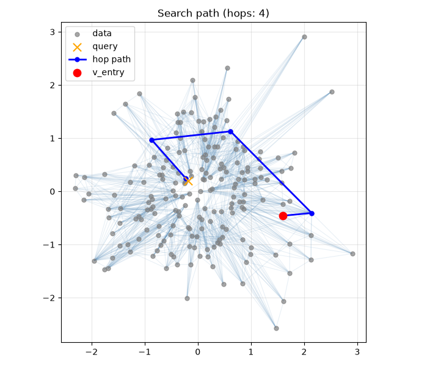
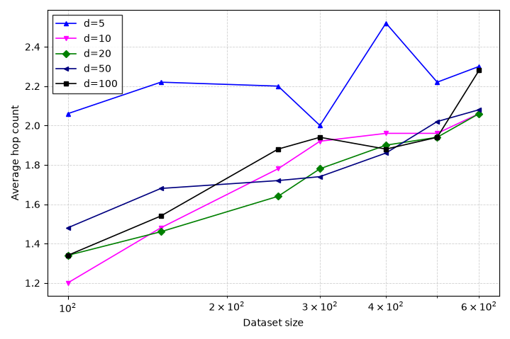
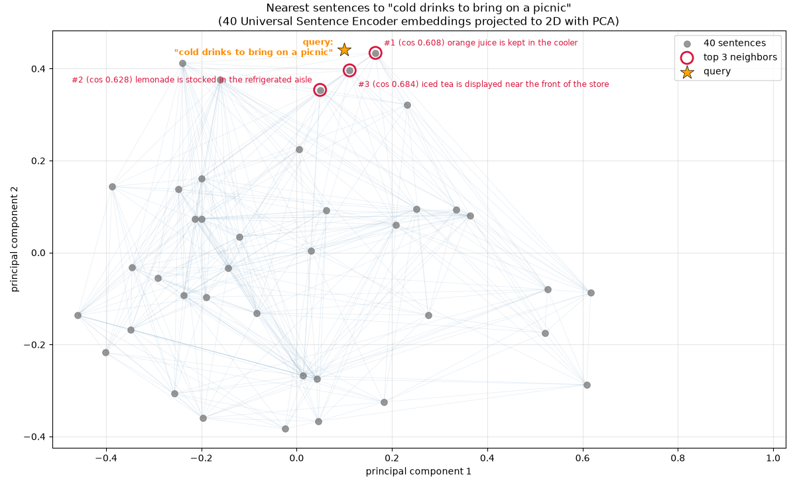

# Approximate Nearest Neighbor Search with Navigable Small-World Graphs

This project implements an approximate k-nearest-neighbor search algorithm using a navigable small-world graph.
It follows the approach described by Malkov et al. and supports insertion, search, and visualization in metric spaces.

## Features

- Approximate nearest-neighbor search
- Graph insertion and greedy search
- Support for multiple distance spaces:
  - L2
  - Inner product
  - Cosine distance
- 2D search path visualization
- Complexity experiment for average hop count vs. dimensionality

## Set up

- Activate the virtual environment:

```bash
source ./.venv/bin/activate
```

- Install dependencies:

```bash
uv sync
```

## Usage

- Run a 2D search visualization (L2 space):

```bash
uv run ann
```

- Run a visualization of the average hop count across different dimensions (small world navigation properties):
```bash
uv run src/approximate_nearest_neighbor/complexity.py
```

- Run a visualization of a semantic search using TensorFlow's Universal Sentence Encoder to embed a set of sentences and a query
```bash
uv run src/approximate_nearest_neighbor/semantic.py
```

- Run the test suite:
```bash
uv run ann-test
```

## Example output





## How it works

The graph stores each data point as a vertex. During insertion, a new point is connected to a small set of nearby vertices. During search, the algorithm starts from an entry point and greedily moves through the graph toward vertices that are closer to the query.

This makes the search approximate but fast, especially for large datasets.

## Parameters

- w: number of multi-search runs used to approximate nearest neighbors during insertion
- f: number of neighbors each new vertex connects to
- space: distance function to use
- seed: random seed for reproducible results
- n_samples: number of generated points
- dimension: dimensionality of the data


## References
```
@article{MALKOV201461,
title = {Approximate nearest neighbor algorithm based on navigable small world graphs},
journal = {Information Systems},
volume = {45},
pages = {61-68},
year = {2014},
issn = {0306-4379},
doi = {https://doi.org/10.1016/j.is.2013.10.006},
url = {https://www.sciencedirect.com/science/article/pii/S0306437913001300},
author = {Yury Malkov and Alexander Ponomarenko and Andrey Logvinov and Vladimir Krylov},
keywords = {Similarity search, k-Nearest neighbor, Approximate nearest neighbor, Navigable small world, Distributed data structure},
abstract = {We propose a novel approach to solving the approximate k-nearest neighbor search problem in metric spaces. The search structure is based on a navigable small world graph with vertices corresponding to the stored elements, edges to links between them, and a variation of greedy algorithm for searching. The navigable small world is created simply by keeping old Delaunay graph approximation links produced at the start of construction. The approach is very universal, defined in terms of arbitrary metric spaces and at the same time it is very simple. The algorithm handles insertions in the same way as queries: by finding approximate neighbors for the inserted element and connecting it to them. Both search and insertion can be done in parallel requiring only local information from the structure. The structure can be made distributed. The accuracy of the probabilistic k-nearest neighbor queries can be adjusted without rebuilding the structure. The performed simulation for data in the Euclidean spaces shows that the structure built using the proposed algorithm has small world navigation properties with log2(n) insertion and search complexity at fixed accuracy, and performs well at high dimensionality. Simulation on a CoPHiR dataset revealed its high efficiency in case of large datasets (more than an order of magnitude less metric computations at fixed recall) compared to permutation indexes. Only 0.03% of the 10 million 208-dimensional vector dataset is needed to be evaluated to achieve 0.999 recall (virtually exact search). For recall 0.93 processing speed 2800queries/s can be achieved on a dual Intel X5675 Xenon server node with Java implementation.}
}
```
